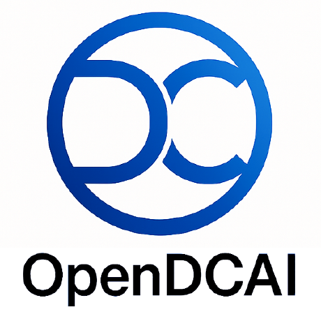

# CoworkEvoBench

<p align="center">
  <a href="https://github.com/OpenDCAI"></a>
</p>

<p align="center">
  <strong>EvoCowork: Experience-Driven Harness Evolution for Real-World Office Tasks</strong>
</p>

<p align="center">
  A reproducible benchmark for agents that read, transform, and deliver office files.
</p>

<p align="center">
  <a href="https://github.com/DeepThinkingZhouLiu/cowork-evolution-benchmark"></a>
  
  
  
  
</p>

<p align="center">
  <a href="#overview">Overview</a> ·
  <a href="#benchmark-scope">Benchmark scope</a> ·
  <a href="#evaluation">Evaluation</a> ·
  <a href="#quick-start">Quick start</a> ·
  <a href="#repository-map">Repository map</a>
</p>


## Overview

CoworkEvoBench evaluates whether an agent harness can turn real office inputs into correct, editable, and mutually consistent deliverables. The benchmark keeps the model and task contracts fixed while leaving a controlled surface on which an evolution method may improve the harness.

Every task is a self-contained Harbor package. It defines the user instruction, visible inputs, runtime image, output contract, hidden reference artifacts, atomic rubric items, and a deterministic judge. The trusted evaluation side owns the hidden reference solution and judge implementation; the agent receives only the task-facing view.

The repository contains the public task packages, release manifests, schemas, validation tools, baseline harness interfaces, evolution policies, provenance records, and reproducibility documentation. It does not commit provider credentials or local run artifacts.

## Benchmark scope

The current `cowork-evo-240-v0.5` release has 240 tasks across four modalities and 59 task families.

| Modality | Tasks | Typical outputs | What it probes |
| --- | ---: | --- | --- |
| Presentation | 60 | PPTX, PDF | Slide editing, reconstruction, layout, charts, and visual communication |
| Document | 60 | DOCX | Structured editing, evidence synthesis, review, and native document objects |
| Spreadsheet | 60 | XLSX | Formula repair, data transformation, reconciliation, modeling, and analysis |
| Cross-office | 60 | Multiple Office files and supporting files | Cross-file propagation, consistency, and compositional delivery |

Each modality uses four structural and empirical tiers: Easy, Medium, Hard, and Expert. The current release records 12 / 18 / 18 / 12 tasks per tier within each modality. The per-task labels, panel scores, and source digests are in [`benchmarks/difficulty-labels-v0.5.csv`](benchmarks/difficulty-labels-v0.5.csv). These labels document the current single-panel calibration evidence; they do not claim independent cross-model validation.

## What a task contains

```text
<modality>/<task-id>/
├── instruction.md              # Agent-visible request and delivery contract
├── task.toml                   # Harbor runtime and public metadata
├── rubric.json                 # Trusted-side atomic rubric
├── environment/Dockerfile      # Reproducible task image
├── data/input_files/            # Agent-visible source files
├── solution/                    # Trusted reference solution and Golden files
├── tests/                       # Judge entry point and deterministic checks
└── metadata/                    # Task labels and provenance records
```

The complete task contract is documented in [`docs/task-spec.md`](docs/task-spec.md). The source, license, privacy, hash, and adaptation boundary for each package are recorded in `metadata/provenance.json` and the accompanying `adaptation/` notes.

## Evaluation

### Three-way evolution split

Release v0.5 separates feedback, candidate selection, and final testing:

| Split | Presentation | Document | Spreadsheet | Cross-office | Total | Role |
| --- | ---: | ---: | ---: | ---: | ---: | --- |
| Feedback | 30 | 30 | 30 | 0 | 90 | Return task-level evidence for harness improvement |
| Selection | 10 | 10 | 10 | 0 | 30 | Return aggregate signals for candidate selection |
| Final | 20 | 20 | 20 | 60 | 120 | Evaluate a frozen harness, including compositional OOD transfer |

The split is fixed by leakage components rather than independent random rows. Shared provenance, inputs, templates, or near-duplicate structure stays in one component. The release manifest and lock files are under [`benchmarks/cowork-evo-240-v0.5/`](benchmarks/cowork-evo-240-v0.5/).

### Trusted scoring pipeline

```text
Agent-visible instruction and inputs
        ↓
Isolated Harbor Docker task
        ↓
Candidate files under the output contract
        ↓
Task Judge: file gates → Office structure → content → cross-file checks → visual checks
        ↓
Versioned single-task result
        ↓
Benchmark aggregation and paired comparison
```

Deterministic checks handle facts, numbers, formulas, file structure, native editability, links, and cross-file consistency. Tasks that require subjective layout or visual judgment may add a task-specific visual rubric; the deterministic and visual components are stored separately and combined according to the task's declared policy. A renderer, VLM, Provider, or other evaluator failure is recorded as an evaluation-infrastructure failure rather than silently converted into an agent score.

### Harbor and JSONL interfaces

Harbor executes one task in an isolated container. A task image is built from its `environment/Dockerfile`, the task-facing instruction and input files are mounted, and only the declared output directory is collected. Release manifests use JSON and JSONL so a runner can stream tasks, split assignments, leakage components, hashes, difficulty labels, and evaluation roles without importing local paths.

The public validator checks task structure and assets. The release freezer checks task-content locks, split membership, and leakage metadata. These checks do not replace a full agent rollout with Docker and Harbor.

## Quick start

The project requires Python 3.11 or newer. Create an isolated environment and install the package:

```bash
python3.11 -m venv .venv
source .venv/bin/activate
python -m pip install -e .
```

Run the repository checks:

```bash
# Unit tests
PYTHONPATH=src python -m unittest discover -s tests/unit

# Validate every public task package
PYTHONPATH=src python -m cowork_evo_bench.cli validate-public-tasks tasks

# Verify the current v0.5 release lock and split metadata
PYTHONPATH=src python tools/freeze_benchmark_release.py --check

# Check the unified difficulty manifest without changing task files
PYTHONPATH=src python tools/sync_difficulty_labels.py
```

The commands above validate the repository and frozen assets locally. A full model evaluation additionally needs Docker, the Harbor runner, a configured harness, and a provider account supplied outside Git.

## Repository map

| Path | Responsibility |
| --- | --- |
| [`tasks/`](tasks/) | Harbor task packages and task-level contracts |
| [`benchmarks/`](benchmarks/) | Immutable release manifests, locks, splits, and leakage groups |
| [`src/`](src/) | Validation, evaluation, judging, adapters, and evolution interfaces |
| [`schemas/`](schemas/) | Shared JSON Schemas |
| [`configs/`](configs/) | Benchmark, evaluation, harness, judge, and taxonomy configuration |
| [`harnesses/`](harnesses/) | Reproducible initial harness definitions |
| [`evolvers/`](evolvers/) | Evolution protocols and reference implementations |
| [`mutation-policies/`](mutation-policies/) | Candidate-harness write allowlists |
| [`datasets/`](datasets/) | Source, license, hash, and audit manifests |
| [`docs/`](docs/) | Architecture, task rules, evaluation, governance, and experiment records |
| [`tests/`](tests/) | Unit, integration, and protocol tests |

Start with [`docs/architecture.md`](docs/architecture.md), [`docs/evaluation-spec.md`](docs/evaluation-spec.md), and [`docs/evolution-protocol.md`](docs/evolution-protocol.md) when extending the benchmark.

## Reproducibility and data boundaries

Tasks, rubrics, judges, budgets, split assignments, and promotion rules are evaluation controls. Evolution code must not modify them. Final tasks, Golden files, hidden rubric details, and judge internals must remain outside the agent-visible runtime view. Private data, credentials, and large run directories stay outside Git; `.env.example` documents names only, while `.env` is ignored.

When a task format, scoring policy, or release changes, create a new release and update the schema, validator, lock, split manifest, and audit record together. Historical releases remain available for result interpretation; they are not edited in place.

## Citation

If you use the benchmark, please cite the accompanying paper once its arXiv record is available:

```bibtex
@misc{li2026evocowork,
  title  = {EvoCowork: Experience-Driven Harness Evolution for Real-World Office Tasks},
  author = {Liu, Zhou and Chen, Xingyan and Han, ZhaoYang and Pan, Zewei and Su, Zeli and Pan, Ningxin and Hu, Xue and Ting, Kaixiong and Zhang, Wentao},
  year   = {2026},
  note   = {Work in progress; see the project repository for the current release}
}
```

## License

The repository does not currently ship a single root license file. Individual task packages carry their applicable source or redistribution conditions; always read the package-level provenance and license records before reuse. Upstream datasets and office files retain their original licenses. A repository-wide license will be added after the maintainers confirm the intended terms for the code and derived task packages.

## Contributing

Please open an issue or pull request with a reproducible description, the affected task or module, validation commands, and any provenance or licensing changes. Do not include credentials, private office files, sealed task contents, or local absolute paths.

## Links

- [GitHub repository](https://github.com/DeepThinkingZhouLiu/cowork-evolution-benchmark)
- [OpenDCAI](https://github.com/OpenDCAI)
- [Release index](benchmarks/README.md)
- [Data governance](docs/data-governance.md)
- [Task specification](docs/task-spec.md)
- [Evaluation specification](docs/evaluation-spec.md)
